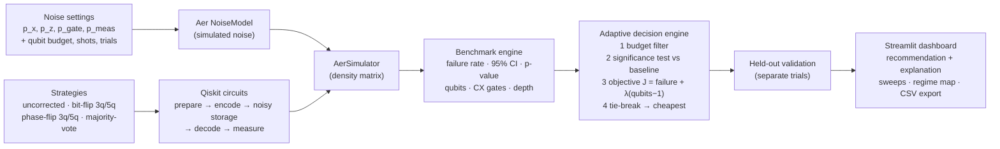

<div align="center">

# Team DeepSpark

**VTU-QFF-HC-0156** &nbsp;|&nbsp; Tier: **Offline**

</div>

---

<div align="center">

| | |
| :--- | :--- |
| **Team** | Team DeepSpark |
| **Team ID** | VTU-QFF-HC-0156 |
| **Tier** | Offline |
| **Repository** | [vtu-hc-team-deepspark](https://github.com/vtu-qiskit-fall-fest-2026/vtu-hc-team-deepspark.git) |
| **Organisation** | [vtu-qiskit-fall-fest-2026](https://github.com/vtu-qiskit-fall-fest-2026) |
| **Event** | VTU-QFF Hackathon — VTU-Qiskit Fall Fest 2026 |

**Live Demo:** [Open Q-Adapt App](https://qiskit-hack-g4j6i2h39rejuyqid7njpu.streamlit.app/)

An adaptive quantum error correction project.

</div>

---

## 📌 Table of Contents

- [Team Members](#-team-members-github-ids)
- [Problem Statement](#-problem-statement)
- [Proposed Solution](#-proposed-solution)
- [Approach & Architecture](#-approach--architecture)
- [Tech Stack](#-tech-stack)
- [Project Structure](#-project-structure)
- [How to Run](#-how-to-run)
- [How to Push Code](#-how-to-push-code)
- [Submission Checklist](#-submission-checklist)
- [Resources](#-resources)
- [License](#-license)

---

## 👥 Team Members (GitHub IDs)

> Members are added to this repository as **collaborators** and must accept the
> GitHub invitation before they can push. Add your GitHub username below.

| # | Name | GitHub Username | Role |
| :-- | :--- | :--- | :--- |
| 1 | Krishna Malloli | Krishna Malloli| _Team Lead_ |
| 2 | Sanvi N Eklaspur | Sanvi Naveeen Eklaspur | _Developer_ |
| 3 | Stuthi Patrick | Stuthi Patrick | _Developer_ |

<!--
Optional: add a plain list instead of the table above.
- @username1
- @username2
-->

---

## ❓ Problem Statement

<!--
State the problem you are solving. Be specific: what is broken or missing,
who experiences it, and why does it matter. Link to the official problem
statement from the brief if one applies.
-->

**Problem:**Quantum computers are sensitive to noise, which can cause incorrect results. Our project, Q-Adapt, uses Qiskit to identify simulated noise conditions and select a suitable error-correction strategy to improve reliability while minimizing additional resource usage.


**Why it matters:**Quantum computers are fragile. Noise from imperfect gates, qubit decay and readout
errors can silently corrupt results, so the output cannot be trusted.
Quantum error correction can help, but it is not free. Every code adds qubits,
gates and circuit depth, and those extra gates are noisy too. Used in the wrong
situation, a code makes results worse. In our tests, the bit-flip code under
phase-flip noise gave 0.017 error against 0.0050 for doing nothing.

Today, choosing a strategy is mostly manual and one-size-fits-all. Q-Adapt
replaces that guesswork. It measures the noise, then picks the cheapest strategy
that actually improves reliability, including doing nothing when correction
would hurt.

This matters because qubits are scarce on today's hardware. Spending them only
where they pay off makes better use of limited devices. On 120 unseen noise
conditions, Q-Adapt cut mean logical error by about 8% against no correction
and about 40% against always-on codes, using fewer qubits than the fixed codes.

**Track / Category:**  Offline  · Track 1  · Quantum Hardware & Error Correction_

---

## 💡 Proposed Solution

<!--
Describe your solution. Keep it concrete: the core idea, the user flow, and
the quantum/ML technique you are applying.
-->

**Solution:** 

Q-Adapt uses Qiskit to measure the simulated noise on a device with small calibration circuits, then picks the error-correction strategy (none, readout mitigation, bit-flip, phase-flip or Shor-9) with the lowest logical error within the user's qubit budget. It chooses "do nothing" when correction would add more noise than it removes, which cuts mean logical error by about 40% against always-on codes while using fewer qubits.

**Key idea:**  _Measure the noise first, then pick the cheapest error-correction strategy that actually lowers logical error, including doing nothing when correction would hurt._

**Why this works:**  Error correction is not free: extra qubits and gates add their own errors, so the best strategy depends on the noise. Q-Adapt does not guess. It simulates noise in Qiskit Aer, runs real experiments on an uncorrected qubit and on bit-flip, phase-flip and majority-vote repetition codes, and measures logical failure rate with confidence intervals, plus qubit count, CX gates and depth. A transparent decision engine then excludes strategies over the qubit budget, keeps only those that beat the baseline in a significance test, and picks the cheapest of any tied options. Its choice is checked on separate held-out runs, so the improvement is not an artefact of selection. The results show why this works: bit-flip noise picks the bit-flip code (3 qubits, then 5 as noise grows), phase-flip noise picks the phase code, and mixed noise or imperfect gates correctly give no correction. Noise is simulated, not hardware data, and the codes protect only one error type, which the app states openly.

## 🧩 Approach & Architecture

<!--
Walk through how it works. A simple pipeline diagram in text or Mermaid is ideal.
-->

Q-Adapt runs a **logical-memory experiment** for each error-correction strategy. It prepares a logical qubit (|0⟩, and |+⟩ for the full quantum task), encodes it, lets simulated noise act, decodes it and measures. A run fails when the decoded bit is wrong. Real Qiskit Aer counts turn into metrics, and an adaptive engine picks the best strategy using only those measurements.



**Pipeline in plain words**
1. **Noise:** you set bit-flip, phase-flip, gate and measurement error. These are simulated settings, not hardware data.
2. **Circuits:** each strategy is built in Qiskit and rewritten into one common gate set, so gate counts compare fairly.
3. **Simulation:** Aer runs every strategy under the same noise, over repeated trials.
4. **Metrics:** logical failure rate with Wilson 95% confidence intervals, improvement over the uncorrected baseline, physical qubits, CX gates and depth.
5. **Decision:** drop strategies over the qubit budget, keep only those that statistically beat the baseline, minimise the objective J, and prefer the cheapest if tied. The engine falls back to *no correction* when nothing helps.
6. **Validation:** trials alternate between calibration, which the engine uses to choose, and held-out runs, which report how the chosen strategy really performs.
7. **Output:** the dashboard shows the recommendation with its reasoning, graphs, a noise-regime map and downloadable results.

**Key modules:** `noise_models.py`, `strategies.py`, `circuits.py`, `benchmarks.py`, `adaptive.py` and `app.py`.

1. **Input** — Noise settings chosen by the user, with no external dataset: bit-flip `p_x`, phase-flip `p_z`, CX-gate error `p_gate` and measurement error `p_meas` (each a probability from 0 to 1). The user also sets the shots per circuit, the number of repeated trials, a random seed, a physical-qubit budget, a resource weight λ and a significance level α. These are simulated settings, not real-hardware data.
2. **Preprocessing** — The noise settings are turned into a Qiskit Aer `NoiseModel` (Pauli X/Z errors on the storage step, depolarizing error on CX gates, read-out error). Each strategy's circuit is rewritten into one common gate set (`id, h, x, sx, rz, cx`) so gate counts and depth compare fairly. Logical states |0⟩ and |+⟩ are prepared and encoded into 1, 3 or 5 physical qubits.
3. **Quantum core** — Repetition-code memory experiments simulated with Aer's density-matrix method. The strategies are uncorrected, 3-qubit and 5-qubit bit-flip codes, 3-qubit and 5-qubit phase-flip codes, and majority-vote (simplified classical-bit only). Each runs encode → noisy storage → decode (coherent Toffoli or majority gates) → measure.
4. **Post-processing** — Measurement counts become logical failure rate and success probability, with Wilson 95% confidence intervals and a one-sided significance test against the uncorrected baseline. Physical qubits, CX count and circuit depth are recorded. The adaptive engine excludes strategies over the qubit budget and scores the rest with J = failure + λ·(qubits − 1). It picks the cheapest of any statistically tied options and confirms the choice on separate held-out trials.
5. **Output** — The dashboard shows the recommended strategy with a plain-language explanation, a strategy comparison table, failure-rate graphs across noise levels, a reliability-vs-resources chart, a noise-regime map and circuit diagrams. It also shows reproducibility info (seed, versions, settings) and CSV/JSON/Markdown export. If no correction helps, it says so.

---

## 🛠️ Tech Stack

| Layer | Technology |
| :--- | :--- |
| Language | Python 3.11+ |
| Quantum SDK | Qiskit `>=1.0`, Qiskit Aer, Qiskit Runtime |
| Optimisation | Qiskit Optimization / COBYLA / SPSA |
| Simulation | AerSimulator (statevector / noisemodel) |
| Environment | JupyterLab / VS Code, `venv` |
| Version control | Git + GitHub |

---

## 📁 Project Structure

```text
vtu-hc-team-deepspark/
├── README.md                  # Overview, setup, results, limitations
├── requirements.txt           # Python dependencies
├── .gitignore                 # Ignores venv/, __pycache__/
├── app.py                     # Streamlit dashboard (entry point)
├── run_benchmark.py           # Headless benchmark → results/
├── conftest.py                # Pytest path setup
├── .streamlit/
│   └── config.toml            # Dark theme
├── qadapt/                    # Core package
│   ├── __init__.py
│   ├── noise_models.py        # Simulated noise → Aer NoiseModel
│   ├── strategies.py          # Correction strategies and tasks
│   ├── circuits.py            # Qiskit circuit construction, gate metrics
│   ├── benchmarks.py          # Aer runs, metrics, sweeps, regime map
│   ├── adaptive.py            # Adaptive decision engine
│   ├── stats.py               # Wilson CI, significance test
│   └── worker.py              # Single Qiskit thread (Streamlit crash fix)
├── tests/                     # 35 tests: analytic checks, engine, app
│   ├── test_qadapt.py
│   └── test_app_smoke.py
├── results/                   # Real benchmark output (CSV, plot, report)
│   ├── BENCHMARK_REPORT.md
│   ├── benchmark_overview.png
│   ├── TEST_RESULTS.txt
│   └── *.csv
└── docs/                      # Architecture, pitch, demo script
    ├── ARCHITECTURE.md
    └── PITCH_AND_DEMO.md
```

## 🚀 How to Run

### Prerequisites

- Python 3.11 or newer
- [Git](https://git-scm.com/downloads)
- A GitHub account (you need collaborator access to this repo)

### 1. Clone the repository

```bash
git clone https://github.com/vtu-qiskit-fall-fest-2026/vtu-hc-team-deepspark.git
cd vtu-hc-team-deepspark
```

### 2. Create a virtual environment

```bash
python3 -m venv .venv
source .venv/bin/activate        # Linux / macOS
# .venv\Scripts\activate         # Windows (PowerShell)
```

### 3. Install dependencies

```bash
pip install --upgrade pip
pip install -r requirements.txt
```

### 4. Run

```bash
python -m src.main
```

Or launch the notebook workflow:

```bash
jupyter lab
```

### 5. Run the tests

```bash
pytest -q
```

---

## 🔁 How to Push Code

> Full walkthrough: **[Git & Collaboration Handbook](../vtu-hc-guide-git-and-collaboration)** — collaboration
> workflow, branches, pull requests, reviews and conflict resolution.

### Configure Git (first time only)

```bash
git config --global user.name  "Your Name"
git config --global user.email "you@example.com"
```

### Everyday workflow

```bash
# 1. Get the latest changes
git checkout main
git pull origin main

# 2. Create a branch for your work
git checkout -b feature/my-task

# 3. Commit your work
git add .
git commit -m "feat: add variational circuit for the search problem"

# 4. Push the branch
git push -u origin feature/my-task

# 5. Open a Pull Request on GitHub and request a review
#    https://github.com/vtu-qiskit-fall-fest-2026/vtu-hc-team-deepspark/compare/main...feature/my-task

# 6. After approval, merge into main
git checkout main
git pull origin main
git branch -d feature/my-task
```

### Commit message convention

| Prefix | Meaning |
| :--- | :--- |
| `feat:` | New feature |
| `fix:` | Bug fix |
| `docs:` | Documentation only |
| `test:` | Adding or fixing tests |
| `refactor:` | Code restructure, no behaviour change |
| `chore:` | Build/config/dependency changes |

### Useful commands

```bash
git status              # what changed
git log --oneline -10   # recent commits
git diff                # review changes before committing
git stash               # shelve changes temporarily
git pull --rebase       # update your branch on top of main
```

### Collaborating on the same repo

- **Never push directly to `main`** — open a Pull Request.
- **Pull before you push** to avoid rejected commits.
- **Commit often** with clear messages.
- **Resolve conflicts** locally: `git pull --rebase`, fix the files, then `git add` + `git rebase --continue`.
- **Ask for a review** before merging — a second pair of eyes catches bugs fast.

---

## ✅ Submission Checklist

- [ ] Repository created and **public**
- [ ] All team members added as **collaborators** and invitations accepted
- [ ] `README.md` updated with project details, problem statement and solution
- [ ] Team members listed under [Team Members](#-team-members-github-ids)
- [ ] `requirements.txt` committed and project runs from a clean clone
- [ ] Code pushed to `main` and the latest `main` builds successfully
- [ ] Notebooks committed with **cleared outputs** (or use `nbstrip`)
- [ ] `README` includes a demo screenshot / video link
- [ ] Short project summary submitted on the hackathon portal

---

## 📚 Resources

| Resource | Link |
| :--- | :--- |
| 🔁 Git & collaboration handbook | [Git & Collaboration Handbook](../vtu-hc-guide-git-and-collaboration) |
| ❓ Problem statements, solutions & terms | [Problem Statements, Solutions & Terms](../vtu-hc-guide-problem-and-solution) |
| 📄 README writing guide | [README Guide & Template](../vtu-hc-guide-readme-template) |
| ⚛️ Qiskit documentation | https://docs.quantum.ibm.com/ |
| ⚛️ Qiskit Runtime & primitives | https://quantum.cloud.ibm.com/docs/ |
| 🧪 Qiskit Aer simulator | https://docs.quantum.ibm.com/guides/simulator |
| 💻 IBM Quantum Platform | https://quantum.cloud.ibm.com/ |
| 🎓 Qiskit textbook | https://qiskit.qotlabs.org/learning/ |
| 📋 GitHub Docs | https://docs.github.com/ |

---

## 📄 License

Released under the [MIT License](LICENSE). See `LICENSE` for details.

---

<div align="center">

**Team DeepSpark** · Team ID `VTU-QFF-HC-0156` · Tier `Offline`
· Built with ⚛️ Qiskit for the VTU-QFF Hackathon

[⬆ Back to Top](#team-deepspark)

</div>
